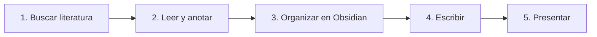
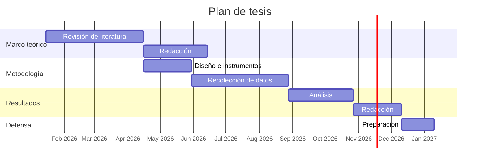
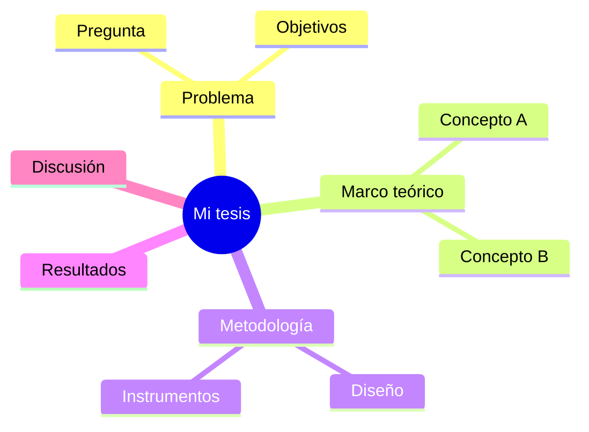
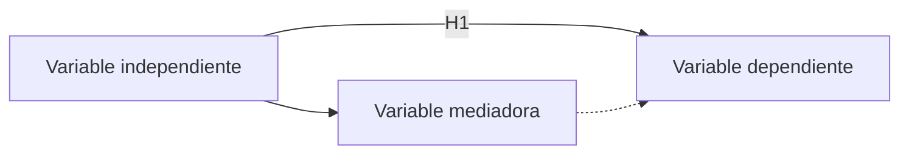

# Diagramas para tu tesis

Obsidian dibuja estos diagramas automáticamente. Copia el bloque, cambia los textos y listo.

## Flujo de trabajo del kit

## Cronograma

## Mapa mental

## Modelo conceptual (variables)

Ver también: [[Bienvenido]]
